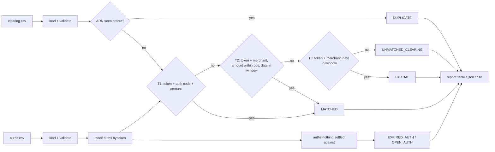

# settlement-recon-cli

[](https://github.com/HelenArams/settlement-recon-cli/actions/workflows/ci.yml)
[](https://pkg.go.dev/github.com/HelenArams/settlement-recon-cli)

Every month-end somebody asks why the clearing totals don't match the auths,
and every time the answer is a spreadsheet with VLOOKUPs that only one person
understands. `recon` is my attempt at writing that spreadsheet down properly:
a small Go CLI that takes the authorizations an issuer approved and the
clearing records the scheme sent back, pairs them up, and tells you what
didn't line up and why.

It's a side project, not a product. It works on CSV exports, keeps
everything in memory and does one thing.

## Why the naive join doesn't work

If every presentment carried the same auth code and the same amount as its
authorization, you'd join on `(card, auth_code, amount)` and go home. In
practice:

- **Partial captures.** A hotel authorizes 250.00 and captures 180.00. A
  marketplace splits one auth into two shipments.
- **FX.** On cross-currency transactions the cleared amount drifts from the
  authorized one by a few basis points because the rate moved overnight.
- **Late presentments.** Merchants present days or weeks after the auth. Car
  rentals are the classic. Meanwhile the issuer has already released the hold.
- **Missing data.** Acquirers drop the auth code, or remap the merchant ID
  between the authorization and the clearing message.
- **Duplicates.** The same ARN shows up twice because a file was resent.
- **Reversals and chargebacks** reference an authorization that already
  settled, possibly in an earlier file.

So matching runs in tiers, strictest first, and everything that isn't a clean
match gets an outcome and a note instead of silently disappearing.

## How it works



Some details that matter:

- Amounts are `int64` minor units the whole way through, parsed from the
  decimal string with the currency's exponent (JPY has 0 decimals, KWD has 3).
  `12.345` in EUR is a load error, not a rounding.
- A presentment *consumes* the auth it matches, so two captures can't settle
  against the same hold. Reversals and chargebacks only *link* to the auth
  they adjust.
- Auths are indexed in maps (`token+code+amount` for T1, `token+currency` for
  T2/T3), so it's not O(n²). On my laptop 100k auths against ~100k clearing
  records reconcile in about 150 ms (`make bench`).
- Output order is fixed (date, then ARN / auth ID), and the "as of" date
  defaults to the latest settlement date in the file rather than today, so
  rerunning last week's files gives last week's report byte for byte.

## Install

```sh
go install github.com/HelenArams/settlement-recon-cli/cmd/recon@latest
```

or grab a binary from [releases](https://github.com/HelenArams/settlement-recon-cli/releases)
(linux, macOS, windows; amd64 and arm64).

## Usage

There are sample files in [`testdata/`](testdata), or `recon sample` writes
them into the current directory. They contain one of everything.

```console
$ recon run --auths testdata/auths.csv --clearing testdata/clearing.csv
Settlement reconciliation as of 2025-02-14
tolerance 50 bps, window 3 days, auth expiry 7 days

OUTCOME             COUNT
MATCHED                10  tier 1: 8, tier 2: 2
PARTIAL                 1  tier 3: 1
UNMATCHED_CLEARING      1
EXPIRED_AUTH            1
DUPLICATE               1
OPEN_AUTH               1
TOTAL                  15  exceptions: 4

NET SETTLEMENT
CCY  PRESENTED  REVERSED  CHARGEBACKS     NET
EUR     282.35    -35.00      -199.00   48.35
GBP       9.99      0.00         0.00    9.99
JPY       1500         0            0    1500
USD     318.20      0.00         0.00  318.20

DATE        OUTCOME             TIER  AUTH ID  ARN                      TOKEN     CCY  AUTHORIZED  CLEARED   DELTA  NOTE
2025-02-05  EXPIRED_AUTH        -     A-1006   -                        tok_c2d8  GBP       15.50        -          open for 9 days, expiry is 7
2025-02-11  MATCHED             T1    A-1001   74000000000000000001001  tok_4f9a  EUR       42.10    42.10    0.00
2025-02-12  MATCHED             T2    A-1002   74000000000000000001002  tok_4f9a  EUR      120.00   120.00    0.00
2025-02-12  MATCHED             T2    A-1003   74000000000000000001003  tok_b71c  USD       89.99    90.20   +0.21  amount off by +0.21 (23 bps)
2025-02-12  PARTIAL             T3    A-1004   74000000000000000001004  tok_b71c  USD      250.00   180.00  -70.00  amount off by -70.00 (2800 bps), outside 50 bps tolerance
...
2025-02-13  DUPLICATE           -     -        74000000000000000001009  tok_4f9a  EUR           -    12.00          ARN already present in the clearing file
2025-02-13  UNMATCHED_CLEARING  -     -        74000000000000000001099  tok_ffff  EUR           -    73.25          no authorization for this card and merchant within the window
2025-02-13  OPEN_AUTH           -     A-1007   -                        tok_e93f  GBP       60.00        -
2025-02-14  MATCHED             T1    A-1011   74000000000000000001012  tok_a6b0  EUR      199.00  -199.00    0.00  settled 17 days after auth, outside 3-day window
$ echo $?
2
```

Flags for `recon run`:

| flag | default | |
|---|---|---|
| `--auths`, `--clearing` | | input files (required) |
| `--tolerance-bps` | `50` | how far a T2 amount may drift, in basis points of the auth amount |
| `--window-days` | `3` | max days between auth and settlement for T2/T3 |
| `--expire-days` | `7` | unmatched auths older than this become `EXPIRED_AUTH` |
| `--as-of` | latest settlement date | reconciliation date, `YYYY-MM-DD` |
| `--format` | `table` | `table`, `json` or `csv`; picked from the `--out` extension if not set |
| `--out`, `-o` | stdout | write the report to a file (written atomically) |

JSON and CSV carry the same data as the table plus both merchant IDs, the
auth timestamp and the clearing type. Amounts are decimal strings so nobody
downstream has to guess the exponent.

`recon validate` checks files without reconciling. It figures out from the
header whether a file is auths or clearing (or use `--kind`) and lists every
bad row:

```console
$ recon validate broken.csv
broken.csv:2: amount: amount "12.345" has more than 2 decimals for EUR
broken.csv:3: timestamp: cannot parse timestamp "yesterday" (want RFC 3339 or YYYY-MM-DD HH:MM:SS)
broken.csv: 2 bad row(s), 0 ok
error: 1 of 1 file(s) failed validation
```

### Exit codes

| code | meaning |
|---|---|
| `0` | everything matched (open auths are fine) |
| `2` | the run worked, but there are exceptions to look at |
| `1` | something is broken: bad flags, unreadable file, invalid rows |

The 2-vs-1 split is so a nightly job can page on a broken file and just
open a ticket for a bad settlement day.

## Matching rules

| tier | requires | outcome | typical case |
|---|---|---|---|
| T1 | same card token, currency, auth code and exact amount (merchant may differ, date isn't checked) | `MATCHED` | the normal case, also catches late presentments and merchant ID remaps (with a note) |
| T2 | same token, currency and merchant; amount within `--tolerance-bps`; settlement within `--window-days` of the auth | `MATCHED` | auth code dropped by the acquirer, FX drift |
| T3 | same token, currency and merchant within the window, any amount | `PARTIAL` | partial capture, tip, FX beyond tolerance |
| none | | `UNMATCHED_CLEARING` | money settled that no auth explains |

Plus the ones that aren't about matching a clearing record:

| outcome | when | exception? |
|---|---|---|
| `DUPLICATE` | the ARN already appeared earlier in the clearing file; it takes no part in matching and is left out of net settlement | yes |
| `EXPIRED_AUTH` | nothing settled against the auth and it's older than `--expire-days` as of the run date | yes |
| `OPEN_AUTH` | nothing settled against it yet, but it's still young | no |

Ties are broken deterministically: T1 prefers the auth closest in date, T2
the closest amount then date, T3 the closest date then amount.

## Input files

CSV with a header row. Column names are matched case-insensitively, spaces
and dashes count as underscores, and a few common aliases are accepted
(`mid` for `merchant_id`, `ccy` for `currency`, `approval_code` for
`auth_code`, ...). Unknown columns are ignored. A UTF-8 BOM and CRLF line
endings are fine, because that's what Excel and most scheme portals produce.

**auths.csv**

| column | required | format |
|---|---|---|
| `id` | yes | any string |
| `card_token` | yes | any string; never a PAN |
| `amount` | yes | decimal in major units, e.g. `42.10`; at most the currency's decimals |
| `currency` | yes | ISO 4217 alpha, e.g. `EUR` |
| `auth_code` | no | approval code; T1 is skipped without it |
| `merchant_id` | yes | |
| `timestamp` | yes | RFC 3339, or `YYYY-MM-DD[ HH:MM[:SS]]` read as UTC |

**clearing.csv**

| column | required | format |
|---|---|---|
| `arn` | yes | acquirer reference number |
| `card_token` | yes | |
| `amount` | yes | positive; the type carries the sign |
| `currency` | yes | |
| `auth_code` | no | |
| `merchant_id` | yes | |
| `settlement_date` | yes | `YYYY-MM-DD` or `YYYYMMDD` |
| `type` | no | `presentment` (default), `reversal` or `chargeback`; a few scheme spellings like `first_chargeback` work too |

## Code layout

```
cmd/recon/         cobra commands, exit codes
internal/model/    Auth, Clearing, money parsing/formatting, bps maths
internal/load/     CSV readers: header aliases, BOM, line-numbered errors
internal/match/    the tiers, duplicate and expiry logic
internal/report/   summary, table/json/csv writers, golden files
internal/sample/   embedded copy of testdata/ for `recon sample`
testdata/          sample inputs
```

## Development

```sh
make test     # go test -race -cover ./...
make lint     # installs golangci-lint v1.63.4 into .tools/ on first run
make bench    # 100k-record matching benchmark
make demo     # build and run against testdata/
```

Report output is covered by golden files in `internal/report/testdata/`. If you
change the output on purpose, regenerate them with
`go test ./internal/report -run Golden -update` and look at the diff.

## Things I'd like to add

- [ ] multi-currency auths: match a USD auth to a EUR clearing using the rate from the clearing file instead of skipping it
- [ ] carry open auths over between runs (a small state file) so a presentment in next week's file still finds its auth
- [ ] split partial captures properly: one auth, several presentments that add up

## License

MIT, see [LICENSE](LICENSE).
